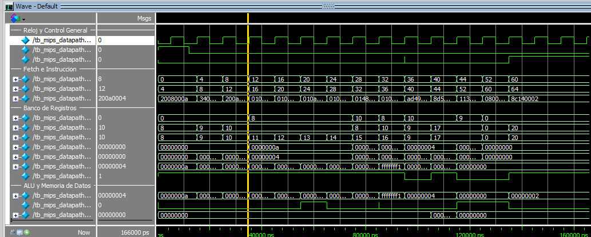

# Evidencias de Validación Incremental (Etapas R, I y J)

Este directorio documenta el desarrollo y verificación modular del procesador MIPS monociclo en ModelSim antes de su integración en el datapath unificado (`RTL/`). Los módulos y vectores de prueba individuales de cada etapa están respaldados en `etapas_separadas/` y en la rama `etapas-separadas`.

---

## 1. Etapa 1: Instrucciones Tipo R (`add`, `sub`, `and`, `or`, `slt`)

Validación de la unidad aritmético-lógica (`ALU`), decodificación de `funct` (`ALU_Control`) y escritura en el banco de registros (`RegDst = 1`, `RegWrite = 1`, `ALUSrc = 0`).

| PC | Instrucción | Operación esperada | Resultado esperado | Resultado observado | Estado |
| :---: | :--- | :--- | :---: | :---: | :---: |
| `0` | `add $10, $8, $9` | `125 + 25` | `150` en `$10` | `ALUResult = 150`, `Dest = 10` | Correcto |
| `4` | `sub $11, $8, $9` | `125 - 25` | `100` en `$11` | `ALUResult = 100`, `Dest = 11` | Correcto |
| `8` | `and $12, $8, $9` | `125 & 25` | `25` en `$12` | `ALUResult = 25`, `Dest = 12` | Correcto |
| `12` | `or $13, $8, $9` | `125 \| 25` | `125` en `$13` | `ALUResult = 125`, `Dest = 13` | Correcto |
| `16` | `slt $14, $9, $8` | `25 < 125 ? 1 : 0` | `1` en `$14` | `ALUResult = 1`, `Dest = 14` | Correcto |

---

## 2. Etapa 2: Instrucciones Tipo I (`lw`, `sw`, `beq`, `slti`, `addi`)

Validación de extensión de inmediato, acceso a memoria de datos (`MemRead`, `MemWrite`) y salto condicional (`beq`) mediante comparación de registros.

| PC | Instrucción | Acción esperada | Señales / Resultado esperado | Resultado observado | Estado |
| :---: | :--- | :--- | :--- | :---: | :---: |
| `0` | `lw $8, 2($16)` | Lee dato en dirección `24 + 2 = 26` | `RegWrite = 1`, `MemWrite = 0`, dato `345` en `$8` | `ALUResult = 26`, `Data = 345`, `Dest = 8` | Correcto |
| `4` | `sw $9, 2($17)` | Escribe `25` en dirección `28 + 2 = 30` | `RegWrite = 0`, `MemWrite = 1` | `ALUResult = 30`, `MemWrite = 1` | Correcto |
| `8` | `beq $14, $14, 1` | Compara `20 == 20` y salta `PC = 12` | `RegWrite = 0`, `PC_Next = 16` | `ALUResult = 0`, `PC` salta directo a `16` | Correcto |
| `16` | `slti $11, $9, 50` | Evalúa `25 < 50 ? 1 : 0` | `RegWrite = 1`, `1` en `$11` | `ALUResult = 1`, `Dest = 11` | Correcto |
| `20` | `addi $12, $9, 927` | Suma registro + inmediato (`23 + 927`) | `RegWrite = 1`, `950` en `$12` | `Resultado = 950`, `Dest = 12` | Correcto |

---

## 3. Etapa 3: Instrucciones Tipo J (`j`)

Validación del desplazamiento de 26 a 28 bits (`Shift_Left_2_Jump`), concatenación con `PC+4[31:28]`, omisión de instrucciones intermedias y autosalto final observable.

| PC | Instrucción | Acción esperada | Señales / Resultado esperado | Resultado observado | Estado |
| :---: | :--- | :--- | :--- | :---: | :---: |
| `0` | `add $10, $8, $9` | Ejecuta `125 + 25` antes del salto | `Jump = 0`, `ALUResult = 150`, `Dest = $10` | `150` guardado en `$10` | Correcto |
| `4` | `j 4` | Salta a palabra `4` (`PC = 16`), omitiendo `PC = 8` y `12` | `Jump = 1`, `RegWrite = 0`, `PC_Next = 16` | `PC` brinca directo de `4` a `16` | Correcto |
| `16` | `or $13, $8, $9` | Ejecuta `125 \| 25` tras aterrizar del salto | `Jump = 0`, `ALUResult = 125`, `Dest = $13` | `125` guardado en `$13` | Correcto |
| `20` | `j 5` | Autosalto incondicional a palabra `5` (`PC = 20`) | `Jump = 1`, `PC` fijo en `20` | `PC` permanece en `20` | Correcto |

---

## 4. Procesador Monociclo Unificado (12 Instrucciones, Memoria *Big-Endian* y `halt`)

* **Módulos bajo prueba:** `RTL/mips_datapath_top.v` y los 12 submódulos integrados.
* **Banco de pruebas:** `VERIF/tb_mips_datapath_top.v` ejecutado mediante `VERIF/run_sim.do` con el programa `VERIF/programa.hex` (formato *Big-Endian*, 1 byte por línea).
* **Registro completo de consola:** [`log_simulacion_unificada.txt`](log_simulacion_unificada.txt).

| PC (Dec / Hex) | Instrucción Ensamblador | Código Máquina | Resultado Esperado | Resultado Observado | Estado |
| :---: | :--- | :---: | :--- | :--- | :---: |
| `0` (`0x00`) | `addi $8, $0, 10` | `0x2008000A` | `$8 = 10` (`0x0000000A`) | `$8 = 10` (`0x0000000A`) | Correcto |
| `4` (`0x04`) | `ori $9, $0, 0x8005` | `0x34098005` | Extensión con ceros (`ZeroExt`): `$9 = 0x00008005` | `$9 = 0x00008005` | Correcto |
| `8` (`0x08`) | `addi $10, $0, 4` | `0x200A0004` | `$10 = 4` (`0x00000004`) | `$10 = 4` (`0x00000004`) | Correcto |
| `12` (`0x0C`) | `add $11, $8, $10` | `0x010A5820` | `$11 = 14` (`0x0000000E`) | `$11 = 14` (`0x0000000E`) | Correcto |
| `16` (`0x10`) | `sub $12, $8, $10` | `0x010A6022` | `$12 = 6` (`0x00000006`) | `$12 = 6` (`0x00000006`) | Correcto |
| `20` (`0x14`) | `and $13, $8, $10` | `0x010A6824` | `$13 = 0` (`0x00000000`), `zf = 1` | `$13 = 0`, `zf = 1` | Correcto |
| `24` (`0x18`) | `or $14, $8, $10` | `0x010A7025` | `$14 = 14` (`0x0000000E`) | `$14 = 14` (`0x0000000E`) | Correcto |
| `28` (`0x1C`) | `slt $15, $10, $8` | `0x0148782A` | `4 < 10` verdadero $\rightarrow$ `$15 = 1` | `$15 = 1` (`0x00000001`) | Correcto |
| `32` (`0x20`) | `nor $16, $8, $10` | `0x010A8027` | `~(10 \| 4)` $\rightarrow$ `$16 = 0xFFFFFFF1` | `$16 = 0xFFFFFFF1` | Correcto |
| `36` (`0x24`) | `sw $9, 0($10)` | `0xAD490000` | Escritura *Big-Endian*: `MEM[4..7] = 00 00 80 05` | `MEM[4..7] = 00 00 80 05` | Correcto |
| `40` (`0x28`) | `lw $17, 0($10)` | `0x8D510000` | Lectura *Big-Endian*: `$17 = 0x00008005` | `$17 = 0x00008005` | Correcto |
| `44` (`0x2C`) | `beq $9, $17, 1` | `0x11310001` | `zf = 1`, salta `PC = 48` (`$18 = 0`) hacia `PC = 52` | Salta a `PC = 52`, `$18 = 0` | Correcto |
| `52` (`0x34`) | `j 15` | `0x0800000F` | Salto incondicional a `15 × 4 = 60` (`$19 = 0`) | Salta a `PC = 60`, `$19 = 0` | Correcto |
| `60` (`0x3C`) | `lw $20, 2($0)` | `0x8C140002` | Dirección desalineada (`2`): `halt = 1`, congela `PC = 60` y bloquea `$20` | `halt = 1`, `PC = 60` congelado (ciclos 13-16), `$20 = 0` | Correcto |
